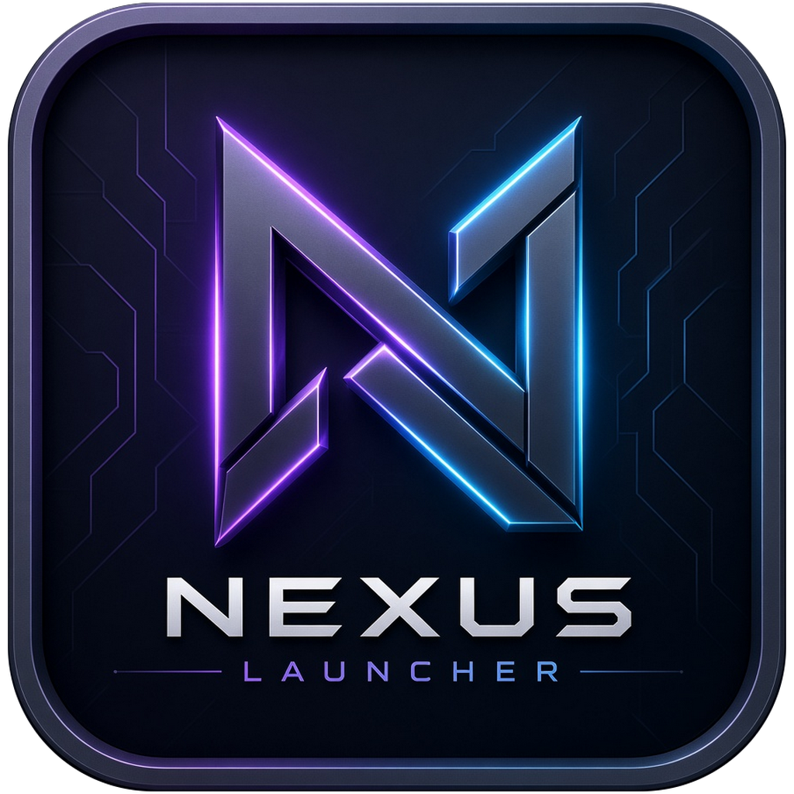

<p align="center">
  
</p>

<h1 align="center">Nexus Launcher</h1>

<p align="center">
  Ứng dụng quản lý và chơi game trên PC: gom mọi game (Steam lẫn ngoài Steam) vào một thư viện,
  tự lấy ảnh bìa, tính giờ chơi, đọc tin tức game.
</p>

---

## Tính năng

### Thư viện game
- Thêm game bằng file `.exe`, shortcut hoặc Steam. Tên game được gợi ý từ thông tin file exe và tên thư mục.
- Có hai kiểu xem: **lưới ảnh bìa dọc** và thẻ ngang. Kích thước ảnh chỉnh được.
- **Ảnh bìa tự động, không cần API key:**
  - Game Steam: tự tìm App ID (thư viện Steam trên máy trước, sau đó tới cửa hàng Steam), lấy ảnh bìa, ảnh nền và logo.
  - Game ngoài Steam: dùng icon của file exe làm ảnh, đặt trên nền là chính icon đó phóng to và làm mờ.
- Tìm ảnh bìa trên [SteamGridDB](https://www.steamgriddb.com/) (cần API key miễn phí), hoặc kéo-thả ảnh từ máy.

### Trang chi tiết game
- **Tổng quan:** mô tả, nhà phát triển, ngày phát hành, thể loại (lấy từ Steam), thư mục cài và dung lượng.
- **Thống kê:** tổng giờ chơi, số phiên, phiên dài nhất, biểu đồ 12 tuần, lịch sử phiên chơi.
- **Tin tức** riêng của game; **ảnh và video** (ảnh chụp màn hình, trailer); **ghi chú cá nhân** tự lưu.

### Tính giờ chơi
- Tính giờ theo **thư mục game**: mọi exe trong thư mục game chạy đều được tính.
- Phân biệt **"Đang mở"** (mới mở launcher, chưa tính giờ) và **"Đang chơi"** (game thật đã chạy).
- **Tự nhận game mở ngoài Nexus**, ví dụ mở từ shortcut, từ Steam hay từ launcher riêng của game.
- Khi launcher mở game ở một thư mục khác, app **gợi ý thư mục game** để lần sau tính giờ chính xác hơn.
- **An toàn với anti-cheat:** app chỉ đọc danh sách tiến trình từ Windows. App không mở tiến trình game, không đọc bộ nhớ, không chèn code hay overlay.

### Trang chủ
- Banner giới thiệu game, tự xoay vòng.
- Thống kê giờ chơi 14 ngày gần nhất và chuỗi ngày chơi liên tiếp.
- Các kệ game: Tiếp tục chơi, Yêu thích, Lâu rồi chưa chơi, Chưa chơi, theo thể loại...
- Nút "Hôm nay chơi gì?" chọn ngẫu nhiên một game.
- **Tin tức game** từ ba nguồn:
  - Steam;
  - Bing News / Google News, cả tiếng Việt và tiếng Anh;
  - các trang báo game: GameK, PC Gamer, IGN...
- Theo dõi tin tức cả những game không có trong thư viện.

### Khác
- Hồ sơ người dùng: tên và ảnh đại diện (chữ cái đầu, avatar có sẵn hoặc ảnh tải lên).
- Cài đặt mạng: DNS bảo mật (Cloudflare / Google) và proxy riêng cho app, để dùng khi Steam bị chặn.
- Giao diện tiếng Việt, font Roboto đóng gói kèm app nên dùng được cả khi offline.

## Yêu cầu

| | |
|---|---|
| Hệ điều hành | Windows 10 / 11 (64-bit) |
| Phát triển | [Node.js](https://nodejs.org/) 22 trở lên (đã dùng với Node 24) |

Người dùng cài app **không cần cài thêm gì**: không Python, không Node, không Visual C++ Redistributable.

## Phát triển

```bash
# Cài thư viện
npm install

# Chạy app ở chế độ phát triển (tự tải lại khi sửa giao diện)
npm run dev
```

Sửa code phía main process, preload hoặc cấu trúc database thì cần tắt `npm run dev` rồi chạy lại.

### Các lệnh khác

| Lệnh | Tác dụng |
|---|---|
| `npm run typecheck` | Kiểm tra kiểu TypeScript (main + giao diện) |
| `npm run lint` | Kiểm tra code bằng ESLint |
| `npm run format` | Định dạng code bằng Prettier |
| `npm run build` | Typecheck + build vào thư mục `out/` |
| `npm run build:unpack` | Build bản chạy được không cần cài, vào `dist/win-unpacked/` |
| `npm run build:win` | Build file cài đặt Windows, vào `dist/` |

Hai module native (`better-sqlite3`, `koffi`) đều có sẵn bản biên dịch cho Windows, nên **không cần Python hay Visual Studio Build Tools** để cài hay build.

> Hiện app chỉ hỗ trợ Windows: phần tính giờ dùng API Windows, và gói cài chỉ đóng kèm bản SQLite cho Windows x64.
> Các lệnh `build:mac` / `build:linux` còn trong `package.json` nhưng chưa dùng được.

## Công nghệ

- [Electron](https://www.electronjs.org/) + [electron-vite](https://electron-vite.org/)
- [React 19](https://react.dev/) + TypeScript
- [better-sqlite3](https://github.com/WiseLibs/better-sqlite3): lưu thư viện game, phiên chơi, cài đặt
- [koffi](https://koffi.dev/): gọi API Windows để đọc danh sách tiến trình
- [resedit](https://github.com/jet2jet/resedit-js): đọc icon và thông tin từ file exe
- [fast-xml-parser](https://github.com/NaturalIntelligence/fast-xml-parser): đọc RSS tin tức

## Cấu trúc thư mục

```
src/
├── main/                 # Main process (Node.js)
│   ├── database/         # Kết nối SQLite + migration
│   ├── ipc/              # Các kênh IPC cho giao diện gọi
│   └── services/         # Logic: game, ảnh bìa, tin tức, tính giờ chơi, mạng...
├── preload/              # Cầu nối an toàn giữa main và giao diện (window.electronAPI)
└── renderer/             # Giao diện React
    └── src/
        ├── pages/        # Trang chủ, Kho game, Chi tiết game, Cài đặt
        ├── components/
        ├── hooks/
        └── assets/       # CSS, ảnh
```

## Dữ liệu người dùng

Toàn bộ dữ liệu nằm ở `%APPDATA%\game-launcher\`:
- `games.db`: thư viện game, phiên chơi, hồ sơ, cài đặt;
- `covers\`: ảnh bìa;
- `avatars\`: ảnh đại diện;
- `news-images\`: ảnh tin tức, tự xoá sau 14 ngày.

API key SteamGridDB được mã hoá bằng `safeStorage` của Windows, nên copy file database sang máy khác cũng không đọc được key.
